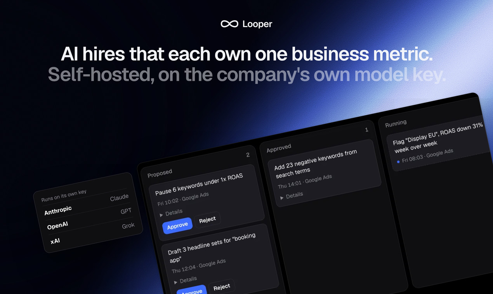
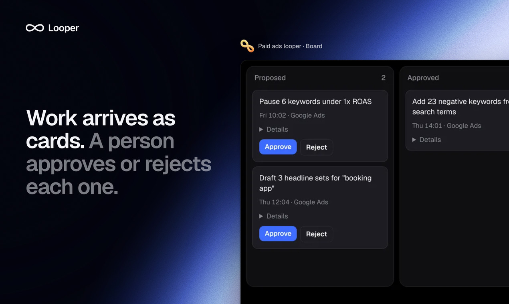
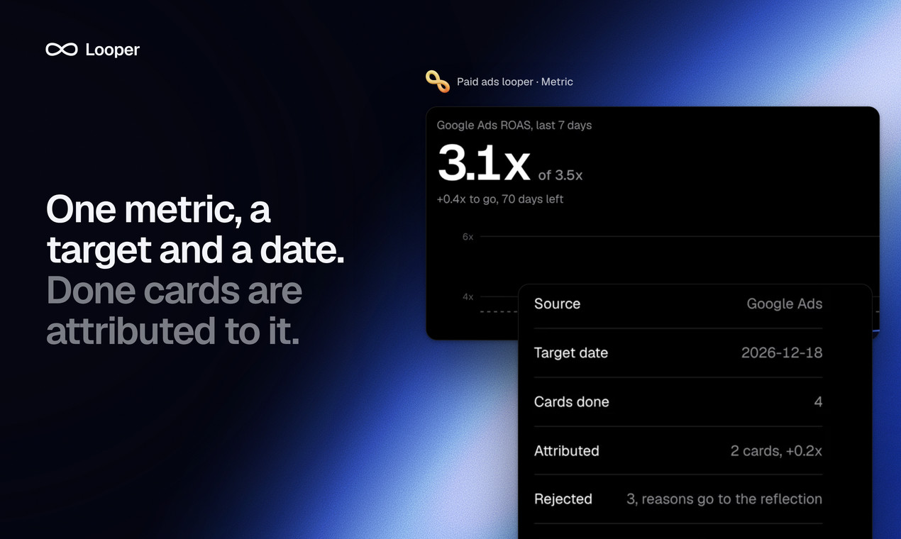
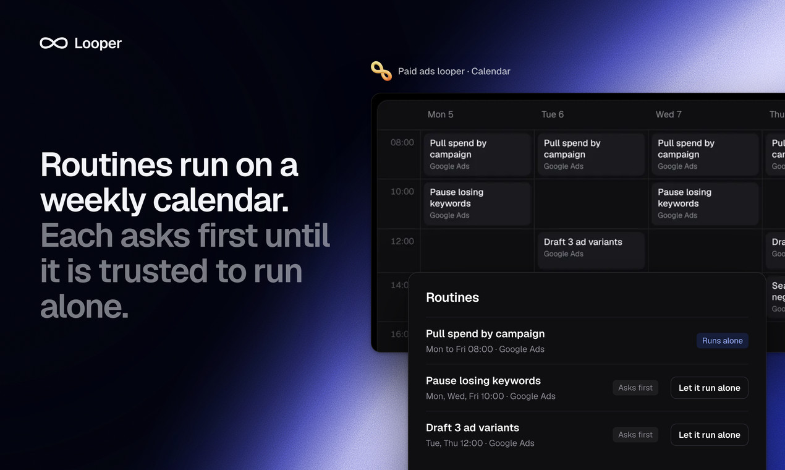
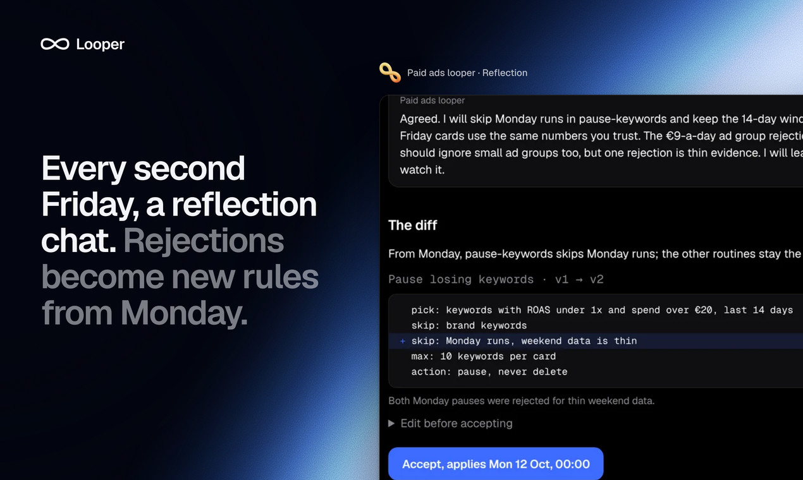
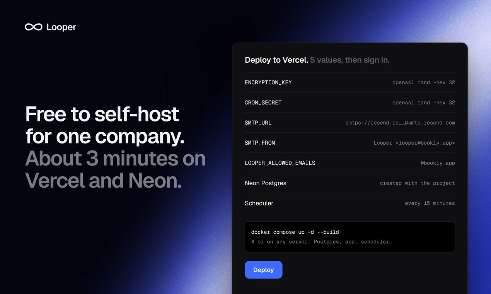

# Looper



AI hires that each own one business metric. A looper reads your tools every day, proposes work as cards on a board, and runs a card once you approve it. Every second Friday it opens a reflection chat about what worked.

This is the self-hosted Looper, the same app that runs [hirelooper.com](https://hirelooper.com). Free for your own use, see [License](#license).

[](https://vercel.com/new/clone?repository-url=https%3A%2F%2Fgithub.com%2FHireLooper-com%2Flooper&project-name=looper&repository-name=looper&env=LOOPS_API_KEY%2CLOOPS_TEMPLATE_ID%2CCOMPOSIO_API_KEY%2CLOOPER_ALLOWED_EMAILS&envDescription=Keys+from+Loops+and+Composio%2C+and+who+may+sign+up.&envLink=https%3A%2F%2Fgithub.com%2FHireLooper-com%2Flooper%23deploy-to-vercel&stores=%5B%7B%22type%22%3A%22integration%22%2C%22integrationSlug%22%3A%22neon%22%2C%22productSlug%22%3A%22neon%22%2C%22protocol%22%3A%22storage%22%7D%5D)

## What a looper does

- Owns one metric with a target and a date, like "qualified leads, 38 of 50 by Friday"
- Runs routines on a calendar and turns them into cards: Proposed, Approved, Running, Done
- Works in your tools through [Composio](https://composio.dev) (57 toolkits) or custom HTTP connectors
- Runs on your own model key: Anthropic, OpenAI or xAI
- Opens pull requests on GitHub for SEO pages and bug fixes, within file and line limits you set

<p>
  
  
  
  
</p>

## Deploy to Vercel

About 15 minutes, most of it in two sign-ups. Have these open in tabs before you press the button.

**1. Loops, for sign-in emails.** Sign up at [loops.so](https://loops.so).
- Settings → Domain: verify the domain your emails come from.
- Transactional → New: one email with 3 data variables, `subject`, `heading` and `body`. Put `subject` in the subject line, `heading` and `body` in the email. Publish it and copy its ID. Looper sends every email (sign-in codes, digests, the Monday report) through this one template.
- Settings → API: create a key.

**2. Composio, for your tools.** Sign up at [composio.dev](https://composio.dev).
- Auth Configs: add 3 tools to start, with Composio managed auth. For example GitHub, Google Search Console and Gmail. You can add any of the 57 later; Looper only offers the ones you added.
- Settings → API Keys: copy the project key.

**3. Press the button.** Vercel copies this repo to your GitHub, adds a Neon Postgres database and asks for 4 values:

| Variable | What to put |
|---|---|
| `LOOPS_API_KEY` | The Loops API key |
| `LOOPS_TEMPLATE_ID` | The ID of the Loops transactional email |
| `COMPOSIO_API_KEY` | The Composio project key |
| `LOOPER_ALLOWED_EMAILS` | Who may sign up: `you@yourcompany.com`, or `@yourcompany.com` for your whole team. Your app URL is public, so set this |

**4. After the deploy:**
1. Open your new URL, sign up with the code from your inbox, and paste an Anthropic, OpenAI or xAI key.
2. In Settings → Scheduler, follow the 3 links. They add a GitHub workflow that runs loopers every 15 minutes; Vercel Hobby alone runs them once a day. On Vercel Pro you can instead set the schedule in `vercel.json` to `*/15 * * * *`.

The encryption key for model keys and the scheduler secret are derived from your database URL, so there is nothing to generate. To set your own, add `ENCRYPTION_KEY` and `CRON_SECRET` in Vercel before you paste a model key. If you reset the Neon password, paste your model key again and update the `CRON_SECRET` Actions secret from Settings → Scheduler.



## Run it with Docker

Postgres, the app and a scheduler that ticks every 15 minutes:

```
git clone https://github.com/HireLooper-com/looper && cd looper/deploy/enterprise
cp .env.example .env        # fill in every value
docker compose up -d --build
```

Full guide: [`deploy/enterprise/README.md`](deploy/enterprise/README.md).

## Run it locally

Node 22 and a Postgres database.

```
npm install
cp .env.example .env.local   # set DATABASE_URL, ENCRYPTION_KEY, CRON_SECRET
npm run dev
```

Tables are created on the first request. Without `LOOPS_API_KEY` or `SMTP_URL`, sign-in codes print to the dev server log; in production one of them is required. The scheduler is one endpoint: call `/api/cron/tick` with `authorization: Bearer $CRON_SECRET` every 15 minutes.

```
npm test
npm run build
```

`CLAUDE.md` maps the codebase file by file.

## License

[Functional Source License 1.1, Apache 2.0 future license](LICENSE.md) (FSL-1.1-ALv2).

- Free to use, modify and self-host for your own company, for education and for research
- Free to use when you run it for a client as a consultant
- Not allowed: selling Looper, or a service built on it that competes with hirelooper.com
- Each version becomes Apache 2.0 two years after its release

Want to resell or white-label it? Write to hello@hirelooper.com.

## Contributing

Issues and pull requests are welcome. This repository is exported from the hirelooper.com codebase, so a merged pull request is ported there by hand and comes back in the next export.
